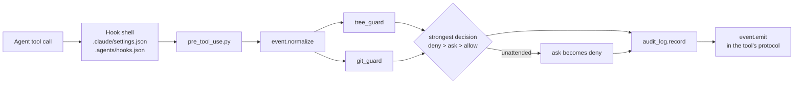

# agent-harness

Guardrails and plumbing for running coding agents (Claude Code and Google Antigravity) on real work:
**where each agent may write, what it did, what it decided on its own, and what it cost.**

It is the tool-agnostic core of a private harness I use in production for game localization, where several
agents (a drafter and parallel reviewers) work on client files. Everything client-specific was left out, and
the demo project in this repository is invented: no real game, client or product.

Python 3.11+, standard library only.

## The problem

An agent with shell access can write anywhere. In a project with client deliverables, reference material and
logs, that is a liability. Some files must never change, some only grow, and some may only be written by a
specific script. On top of that:

- prompts are not enforcement: "never edit the glossary" in a system prompt is a suggestion;
- two tools (Claude Code and Antigravity) have different hook protocols for the same rules;
- when agents run in a loop with nobody watching, a confirmation prompt stalls everything;
- agents make small decisions on their own (a file name, a format, what to leave out) that nobody reviews;
- "how much did that run cost?" needs real token counts per agent, not the number a subagent reports.

## What is in here

| Piece | File | What it does |
|---|---|---|
| Write-zone map | `.agents/tree.toml`, `tools/tree.py` | Every path falls into one zone with a mode: `free`, `deliver`, `append`, `ask`, `script` or `blocked`. Anything outside the map is blocked. |
| Hook entry point | `tools/guards/pre_tool_use.py`, `event.py` | One PreToolUse hook for both tools: normalizes each tool's event, runs the guards, answers in each tool's protocol. |
| Tree guard | `tools/guards/tree_guard.py` | Applies the map to file tools and, best effort, to shell commands: redirects, `rm`/`mv`/`cp`/`sed -i`, PowerShell cmdlets, `cd` chains, and Python code in `-c` or heredocs. |
| Git guard | `tools/guards/git_guard.py` | No `--no-verify`, no `git add -f`, push only to remotes with an allowed visibility (fails closed), no accidental public repositories. |
| Unattended mode | `pre_tool_use.py` | With `HARNESS_UNATTENDED=1`, every "ask" becomes a "deny" with instructions, so a loop never waits for a human who is not there. |
| Audit log | `tools/audit_log.py` | Append-only JSONL per session: every write and shell command, the files it targets and the guard's decision. Query by session or by file. |
| Decision queue | `tools/pending.py` | Agents record decisions they made by inference and questions that did not block them; the human approves by id later. Lock file and atomic replace keep parallel sessions safe. |
| Worker runs | `tools/runs.py` | Each worker run is a new file with a unique name, in an append-only zone: parallel workers and reruns never overwrite each other. |
| Fixed-rule merge | `tools/merge_reviews.py` | Merges a drafter with prioritized reviewers by code instead of an LLM judge, and flags for the human only the segments that need a decision. |
| Cost per agent | `tools/session_cost.py` | Reads Claude Code transcripts and sums input, cache and output tokens per agent and subagent. |
| One source, two tools | `tools/sync_adapters.py` | Skills and worker prompts live in `.agents/`; the copies Claude Code needs in `.claude/` are generated and checked in CI. |

## How a write is decided



The map is the single source of truth. The guard, the `check` command and the tests all read it:

```toml
[[zone]]
path = "projects/*/references/**"
mode = "blocked"
note = "Reference material from the client: read-only."

[[zone]]
path = "projects/*/references/glossary.csv"   # the last matching zone wins
mode = "ask"

[[zone]]
path = "projects/*/jobs/*/wip/runs/**"
mode = "append"
note = "Worker output, one file per run: two runs never overwrite each other."
```

## Try it

```bash
git clone https://github.com/ddmdros/agent-harness && cd agent-harness

# Which zone is a path in?
python -I tools/tree.py where projects/sample-rpg/references/glossary.csv

# Feed the hook an event, as Claude Code would
echo '{"tool_name":"Bash","tool_input":{"command":"rm -rf projects/sample-rpg/references"}}' \
  | python -I tools/guards/pre_tool_use.py; echo "exit $?"
# -> BLOCKED by the write-zone map: ... (blocked) ... exit 2

# Merge the demo job: a drafter and two reviewers, already run
python -I tools/merge_reviews.py projects/sample-rpg/jobs/2026-11-patch/wip
# -> 5 segments, 2 changed by review, 2 need the human

# Record a decision an agent made on its own, then approve it
python -I tools/pending.py decision "Runs are named <time>-<session>-<worker>.json" --why "sortable and unique"
python -I tools/pending.py answer D001 ok

# Tests
python -I -m unittest discover -s tests -v
```

To use it in your own project, copy `tools/`, `.agents/tree.toml` and the two hook shells, then write your
own zones. Open the folder in Claude Code or Antigravity and the hooks are active.

## The demo job

`projects/sample-rpg/jobs/2026-11-patch/` holds a small EN to PT-BR job with the output of three workers
(`.agents/workers/`): a drafter, a mechanics reviewer (glossary, placeholders, length) and a style reviewer.
The merge shows the rule at work:

- `ui_002`: both reviewers changed the draft. The mechanics reviewer wins by priority (the glossary says
  *Stamina = Vigor*), and the style proposal stays as an alternative with a warning.
- `dlg_001`: the style reviewer escalates a gendered greeting. The text does not change, and the human decides.
- `dlg_003`: a style-only change is applied, and the draft stays as an alternative.

## Design decisions

The reasoning behind each piece is in [`docs/decisions/`](docs/decisions/). They are condensed from the
architecture decision records of the production harness:

1. [Hooks enforce, prompts inform](docs/decisions/0001-hooks-enforce-prompts-inform.md)
2. [One write-zone map, last match wins, default blocked](docs/decisions/0002-write-zone-map.md)
3. [One entry point for every agent tool](docs/decisions/0003-one-entry-point-for-every-tool.md)
4. [Unattended mode turns "ask" into "deny"](docs/decisions/0004-unattended-mode.md)
5. [Decisions by inference go to a queue for approval](docs/decisions/0005-decision-queue.md)
6. [A fixed merge rule instead of an LLM judge](docs/decisions/0006-fixed-merge-rule.md)

## Limits

- The shell guard reads command **text**. Paths built at runtime (`open(sys.argv[1], 'w')`, `rm $f`) are not
  resolved. When a Python write has no readable target, the guard falls back to a strict rule. It is a strong
  seatbelt, not a sandbox: use it together with OS-level permissions when the stakes are high.
- It errs on the safe side: a commit message that quotes `--no-verify` is denied (see `tests/test_git_guard.py`).
- `session_cost.py` reads Claude Code transcripts only. The "equivalent" figure compares runs and is not a price.
- The Antigravity session id field in hook events is not confirmed yet. The audit log tries the likely keys and
  falls back to the parent process id.

## License

MIT. See [LICENSE](LICENSE).
