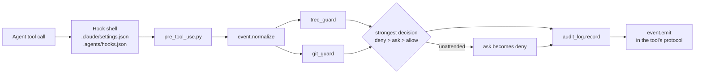

# agent-harness

Guards and infrastructure for coding agents (Claude Code and Google Antigravity) that work on a project's files:
**where each agent may write, what it did, what it decided on its own, and what it cost.**

It is built around a game translation workflow: several agents (a drafter and reviewers running in parallel) work
on each project's files, and a person decides what needs judgment. The demo project in this repository,
`projects/sample-rpg`, is invented: there is no real game, company or product.

Python 3.11+, standard library only.

## The problem

An agent with terminal access can write anywhere. In a project with deliverables, reference material and
logs, that is a risk: some files must never change, others may only grow, and others may only be written by one
specific script. On top of that:

- a prompt is not a guard: "never edit the glossary" in a prompt is a suggestion;
- two tools (Claude Code and Antigravity) have different hook protocols for the same rules;
- with agents running in a loop and nobody watching, a confirmation prompt stalls everything;
- agents make small decisions on their own (a file name, a format, what to leave out) that nobody reviews;
- to know what a run cost, you have to count the real tokens, per agent, not the number the subagent reports at
  the end.

## What is here

| Piece | File | What it does |
|---|---|---|
| Write-zone map | `.agents/tree.toml`, `tools/tree.py` | Every path falls into a zone with a mode: `free`, `deliver`, `append`, `ask`, `script` or `blocked`. Anything outside the map is blocked. |
| Hook entry point | `tools/guards/pre_tool_use.py`, `event.py` | One PreToolUse hook for both tools: it normalizes each tool's event, runs the guards and answers in each tool's protocol. |
| Tree guard | `tools/guards/tree_guard.py` | Applies the map to file tools and, on a best-effort basis, to terminal commands: redirections, `rm`/`mv`/`cp`/`sed -i`, PowerShell cmdlets, `cd` sequences and Python code in `-c` or a heredoc. |
| Git guard | `tools/guards/git_guard.py` | No `--no-verify` and no `git add -f`; push only to a repository whose visibility is allowed (when in doubt, deny); no public repository by accident. |
| Unattended mode | `pre_tool_use.py` | With `HARNESS_UNATTENDED=1`, every "ask" becomes a "deny" with instructions, so the loop does not wait for someone who is not there. |
| Audit log | `tools/audit_log.py` | One append-only JSONL per session: every write and command, the files it touches and the guard's decision. Query by session or by file. |
| Decision queue | `tools/pending.py` | The agent records the decisions it made by inference and the questions that did not block it; the human approves later, by id. A file lock and an atomic replace keep parallel sessions safe. |
| Worker runs | `tools/runs.py` | Each worker run is a new file with a unique name, in an append-only zone: parallel workers and reruns never overwrite each other. |
| Fixed merge rule | `tools/merge_reviews.py` | Merges the translator and the reviewers (in priority order) in code, instead of an LLM judge, and shows the human only the segments that need a decision. |
| Cost per agent | `tools/session_cost.py` | Reads Claude Code transcripts and sums input, cache and output per agent and subagent. |
| One source, two tools | `tools/sync_adapters.py` | Skills and worker prompts live in `.agents/`; the copies Claude Code needs in `.claude/` are generated and checked in CI. |

## How a write is decided



The map is the single source: the guard, the `check` command and the tests read the same file.

```toml
[[zone]]
path = "projects/*/references/**"
mode = "blocked"
note = "Reference material from the client: read-only."

[[zone]]
path = "projects/*/references/glossary.csv"   # the last matching zone wins
mode = "ask"

[[zone]]
path = "projects/*/jobs/*/wip/runs/**"
mode = "append"
note = "Worker output, one file per run: two runs never overwrite each other."
```

## Try it

```bash
git clone https://github.com/ddmdros/agent-harness && cd agent-harness

# Which zone is a path in?
python -I tools/tree.py where projects/sample-rpg/references/glossary.csv

# Send an event to the hook, as Claude Code would
echo '{"tool_name":"Bash","tool_input":{"command":"rm -rf projects/sample-rpg/references"}}' \
  | python -I tools/guards/pre_tool_use.py; echo "exit $?"
# -> BLOCKED by the write-zone map: ... (blocked) ... exit 2

# Merge the demo job: one translator and two reviewers, already run
python -I tools/merge_reviews.py projects/sample-rpg/jobs/2026-11-patch/wip
# -> 5 segments, 2 changed by review, 2 need the human

# Record a decision the agent made on its own, then approve it
python -I tools/pending.py decision "Runs are named <time>-<session>-<worker>.json" --why "sortable and unique"
python -I tools/pending.py answer D001 ok

# Tests
python -I -m unittest discover -s tests -v
```

To use it in your own project, copy `tools/`, `.agents/tree.toml` and the two hook shells, and write your own
zones. When you open the folder in Claude Code or Antigravity, the hooks are already active.

## The demo job

`projects/sample-rpg/jobs/2026-11-patch/` holds a small EN to PT-BR job with the output of three workers
(`.agents/workers/`): a translator, a mechanics reviewer (glossary, placeholders, length) and a style reviewer.
The merge shows the rule at work:

- `ui_002`: both reviewers changed the draft. The mechanics reviewer wins on priority (the glossary says
  *Stamina = Vigor*), and the style proposal stays as an alternative, with a warning.
- `dlg_001`: the style reviewer escalates a gendered greeting. The text does not change, and the human decides.
- `dlg_003`: a style-only change is applied, and the draft stays as an alternative.

## Design decisions

The reasoning behind each piece is in [`docs/decisions/`](docs/decisions/), written as architecture decision
records (ADRs):

1. [Hooks enforce, prompts inform](docs/decisions/0001-hooks-enforce-prompts-inform.md)
2. [A write-zone map: the last zone wins, everything else is blocked](docs/decisions/0002-write-zone-map.md)
3. [One entry point for every tool](docs/decisions/0003-one-entry-point-for-every-tool.md)
4. [Unattended, "ask" becomes "deny"](docs/decisions/0004-unattended-mode.md)
5. [Decisions made by inference go to an approval queue](docs/decisions/0005-decision-queue.md)
6. [A fixed merge rule instead of an LLM judge](docs/decisions/0006-fixed-merge-rule.md)

## Demo data

Everything in `projects/sample-rpg` is invented for the demo: the strings, the glossary and the reviews. The
repository holds no data from any other project.

## Limits

- The terminal guard reads the **text** of the command. Paths built at run time (`open(sys.argv[1], 'w')`,
  `rm $f`) are not resolved. When a Python write has no readable target, the guard falls back to a stricter rule.
  It is a strong seatbelt, not a sandbox: when the risk is high, use it together with operating-system
  permissions.
- It errs on the safe side: a commit message that mentions `--no-verify` is denied (see
  `tests/test_git_guard.py`).
- `session_cost.py` only reads Claude Code transcripts. The "equivalent" figure is for comparing runs; it is not
  a price.
- It is not yet confirmed which field of the Antigravity hook event carries the session id. The log tries the
  likely names and, failing all of them, uses the parent process id.

## License

MIT. See [LICENSE](LICENSE).
