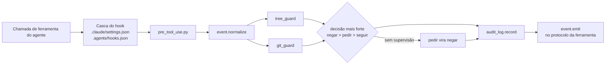

# agent-harness

Travas e infraestrutura para usar agentes de código (Claude Code e Google Antigravity) em trabalho real:
**onde cada agente pode escrever, o que ele fez, o que decidiu sozinho e quanto custou.**

É o núcleo genérico do harness privado que uso no meu trabalho de localização de jogos, só em projetos cujo
contrato permite o uso da ferramenta: vários agentes (um tradutor e revisores em paralelo) trabalhando sobre os
arquivos de cada projeto. O projeto de demonstração deste
repositório é inventado: não há jogo, empresa ou produto real.

Python 3.11+, só a biblioteca padrão. O código está em inglês; a documentação, em português.

## O problema

Um agente com acesso ao terminal escreve em qualquer lugar. Num projeto com entregas de cliente, material de
referência e registros, isso é um risco: alguns arquivos nunca podem mudar, outros só podem crescer, e outros
só podem ser escritos por um script específico. Além disso:

- prompt não é trava: «nunca edite o glossário» no prompt é uma sugestão;
- duas ferramentas (Claude Code e Antigravity) têm protocolos de hook diferentes para as mesmas regras;
- com agentes rodando em loop e ninguém olhando, um pedido de confirmação trava tudo;
- os agentes tomam pequenas decisões sozinhos (um nome de arquivo, um formato, o que deixar de fora) que
  ninguém revisa;
- para saber quanto custou uma rodada, é preciso contar os tokens de verdade, por agente, e não o número que o
  subagente informa no fim.

## O que tem aqui

| Peça | Arquivo | O que faz |
|---|---|---|
| Mapa de zonas de escrita | `.agents/tree.toml`, `tools/tree.py` | Cada caminho cai numa zona com um modo: `free`, `deliver`, `append`, `ask`, `script` ou `blocked`. O que está fora do mapa é bloqueado. |
| Ponto de entrada do hook | `tools/guards/pre_tool_use.py`, `event.py` | Um só hook PreToolUse para as duas ferramentas: normaliza o evento de cada uma, roda as travas e responde no protocolo de cada uma. |
| Trava da árvore | `tools/guards/tree_guard.py` | Aplica o mapa às ferramentas de arquivo e, no melhor esforço, aos comandos de terminal: redirecionamentos, `rm`/`mv`/`cp`/`sed -i`, cmdlets do PowerShell, sequências de `cd` e código Python em `-c` ou heredoc. |
| Trava do git | `tools/guards/git_guard.py` | Nada de `--no-verify` nem `git add -f`; push só para repositório com visibilidade permitida (na dúvida, nega); nada de repositório público por acidente. |
| Modo sem supervisão | `pre_tool_use.py` | Com `HARNESS_UNATTENDED=1`, todo «pedir confirmação» vira «negar» com instruções, e o loop não fica esperando alguém que não está lá. |
| Registro de auditoria | `tools/audit_log.py` | Um JSONL por sessão, só de acréscimo: cada escrita e comando, os arquivos que ele atinge e a decisão da trava. Consulta por sessão ou por arquivo. |
| Fila de decisões | `tools/pending.py` | O agente anota as decisões que tomou por inferência e as dúvidas que não o bloquearam; o humano aprova depois, pelo id. Trava de arquivo e troca atômica mantêm sessões paralelas seguras. |
| Rodadas dos workers | `tools/runs.py` | Cada rodada de um worker é um arquivo novo com nome único, numa zona só de acréscimo: workers em paralelo e reexecuções nunca se sobrescrevem. |
| Junção por regra fixa | `tools/merge_reviews.py` | Junta o tradutor e os revisores (em ordem de prioridade) com código, em vez de um juiz LLM, e mostra ao humano só os segmentos que precisam de decisão. |
| Custo por agente | `tools/session_cost.py` | Lê os transcripts do Claude Code e soma entrada, cache e saída por agente e subagente. |
| Uma fonte, duas ferramentas | `tools/sync_adapters.py` | Skills e prompts dos workers moram em `.agents/`; as cópias de que o Claude Code precisa em `.claude/` são geradas e conferidas no CI. |

## Como uma escrita é decidida



O mapa é a fonte única: a trava, o comando `check` e os testes leem o mesmo arquivo.

```toml
[[zone]]
path = "projects/*/references/**"
mode = "blocked"
note = "Reference material from the client: read-only."

[[zone]]
path = "projects/*/references/glossary.csv"   # vale a última zona que casa
mode = "ask"

[[zone]]
path = "projects/*/jobs/*/wip/runs/**"
mode = "append"
note = "Worker output, one file per run: two runs never overwrite each other."
```

## Para testar

```bash
git clone https://github.com/ddmdros/agent-harness && cd agent-harness

# Em que zona está um caminho?
python -I tools/tree.py where projects/sample-rpg/references/glossary.csv

# Mandar um evento para o hook, como o Claude Code faria
echo '{"tool_name":"Bash","tool_input":{"command":"rm -rf projects/sample-rpg/references"}}' \
  | python -I tools/guards/pre_tool_use.py; echo "exit $?"
# -> BLOCKED by the write-zone map: ... (blocked) ... exit 2

# Juntar o job de demonstração: um tradutor e dois revisores, já rodados
python -I tools/merge_reviews.py projects/sample-rpg/jobs/2026-11-patch/wip
# -> 5 segments, 2 changed by review, 2 need the human

# Anotar uma decisão que o agente tomou sozinho e depois aprovar
python -I tools/pending.py decision "Rodadas se chamam <hora>-<sessão>-<worker>.json" --why "ordenável e único"
python -I tools/pending.py answer D001 ok

# Testes
python -I -m unittest discover -s tests -v
```

Para usar no seu projeto, copie `tools/`, `.agents/tree.toml` e as duas cascas de hook e escreva as suas
zonas. Ao abrir a pasta no Claude Code ou no Antigravity, os hooks já estão ativos.

## O job de demonstração

`projects/sample-rpg/jobs/2026-11-patch/` tem um job pequeno de EN para PT-BR com a saída de três workers
(`.agents/workers/`): um tradutor, um revisor de mecânica (glossário, placeholders, tamanho) e um revisor de
estilo. A junção mostra a regra em ação:

- `ui_002`: os dois revisores mudaram o rascunho. O de mecânica vence pela prioridade (o glossário diz
  *Stamina = Vigor*), e a proposta de estilo fica como alternativa, com aviso.
- `dlg_001`: o revisor de estilo escala uma saudação com gênero. O texto não muda, e quem decide é o humano.
- `dlg_003`: uma mudança só de estilo é aplicada, e o rascunho fica como alternativa.

## Decisões de projeto

O porquê de cada peça está em [`docs/decisions/`](docs/decisions/), resumido dos registros de decisão de
arquitetura (ADRs) do harness de produção:

1. [Hooks garantem, prompts explicam](docs/decisions/0001-hooks-enforce-prompts-inform.md)
2. [Um mapa de zonas de escrita: vale a última zona, o resto é bloqueado](docs/decisions/0002-write-zone-map.md)
3. [Um ponto de entrada para todas as ferramentas](docs/decisions/0003-one-entry-point-for-every-tool.md)
4. [Sem supervisão, «pedir» vira «negar»](docs/decisions/0004-unattended-mode.md)
5. [Decisões por inferência vão para uma fila de aprovação](docs/decisions/0005-decision-queue.md)
6. [Uma regra fixa de junção no lugar de um juiz LLM](docs/decisions/0006-fixed-merge-rule.md)

## Confidencialidade

Este repositório não tem nenhum dado de trabalho real: o código é só o núcleo genérico, a demo é inventada, e os
registros de decisão foram reescritos sem nada de cliente.

## Limites

- A trava do terminal lê o **texto** do comando. Caminhos montados em tempo de execução
  (`open(sys.argv[1], 'w')`, `rm $f`) não são resolvidos. Quando uma escrita em Python não tem alvo legível, a
  trava volta para uma regra mais estrita. É um cinto de segurança forte, não uma sandbox: quando o risco é alto,
  use junto com permissões do sistema operacional.
- Ela erra para o lado seguro: uma mensagem de commit que cita `--no-verify` é negada
  (ver `tests/test_git_guard.py`).
- O `session_cost.py` só lê transcripts do Claude Code. O número «equivalente» serve para comparar rodadas; não
  é preço.
- Ainda não está confirmado em que campo o evento de hook do Antigravity traz o id da sessão. O registro tenta
  os nomes prováveis e, sem nenhum, usa o id do processo pai.

## Licença

MIT. Veja [LICENSE](LICENSE).
